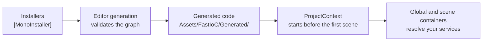

# Core Concepts

[← Back to README](../README.md)

- [Glossary](#glossary)
- [How it works](#how-it-works)
- [Runtime reflection](#runtime-reflection)
- [How it compares](#how-it-compares)

---

## Glossary

| Concept | Meaning |
|---|---|
| Installer | A `BindingRecorder` class with `[MonoInstaller]` that declares bindings in `InstallBindings()` |
| Binding | A rule that tells the container what to provide for a type |
| Project context | The prefab that starts the container before the first scene loads |
| Generated code | The registries, activators and injectors in `Assets/FastIoC/Generated/` |

## How it works

The game runs the generated code, not your installers. The one exception is an installer with a [`FromInstance(value)`](bindings.md#bind-existing-objects) binding, which also runs once at startup.

Since every declaration happens at edit time, a binding is declared in one place: one installer declares it and lists its scenes, instead of repeating it in each scene context that needs it.

## Runtime reflection

The runtime doesn't use reflection:

- The generated `GeneratedModule` registers itself with `[RuntimeInitializeOnLoadMethod]`, so nothing searches assemblies for generated types.
- Generated injectors assign `internal` MonoBehaviour fields directly.
- Scenes are injected from a baked `SceneInjectionManifest`. See [Scene manifests](code-generation.md#scene-manifests).
- Prefabs instantiated through `IInstantiator` or `IPrefabInstantiator` get their data (`IInjectableForChildren<T>`), container fields and local references from generated code.

Generation falls back to reflection only for an `internal` field in a package that doesn't expose its internals to `Assembly-CSharp`. Generation lists these fields in the Console, and `GeneratedMonoInjectors.ReflectionFallbackFieldCount` says how many there are. Add `[assembly: InternalsVisibleTo("Assembly-CSharp")]` to that package to remove the fallback.

Service-locator detection reads a stack trace when your own code calls `Resolve`, in the Editor and development builds only. Generated code skips that check, so resolving dependencies costs the same there as in a release build.

Test IL2CPP builds with code stripping enabled before shipping.

## How it compares

| | Fast IoC | [Extenject (Zenject)](https://github.com/Mathijs-Bakker/Extenject) | [VContainer](https://vcontainer.hadashikick.jp/) | [Reflex](https://github.com/gustavopsantos/Reflex) |
|---|---|---|---|---|
| Where bindings live | Feature installers, found automatically | Installers added to a context | `LifetimeScope` classes | Installers on a scope |
| Scene scoping | Scene names on the installer | `SceneContext` | Child `LifetimeScope`s | Scene containers that inherit from the root |
| Reflection | None at runtime. See [Runtime reflection](#runtime-reflection). | Used by default, with optional reflection baking | Used by default, with an optional Roslyn source generator | Reduced with an optional Roslyn source generator |
| MonoBehaviour injection | `internal` fields | `[Inject]` | `[Inject]` | `[Inject]` |
| Requires generated code in your project | Yes | No | No | No |
| Track record | Pre-release, single author | Long-established, large community | Established, active community | Established, active community |

**Choose Fast IoC** for feature-owned installers and edit-time generation. **Choose one of the others** if you want a proven container or no generated files. Each project publishes its own benchmarks, so compare them against your own workload.
