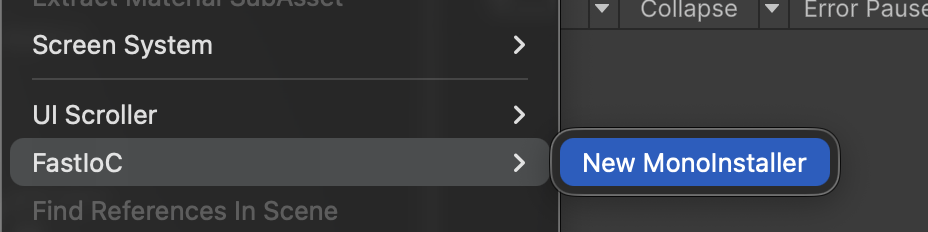

# Getting Started

[← Back to README](../README.md)

- [Requirements](#requirements)
- [Installation](#installation)
- [Setup](#setup)
- [Quick start](#quick-start)
- [Organize bindings by feature](#organize-bindings-by-feature)
- [Editor commands](#editor-commands)
- [Next steps](#next-steps)

---

## Requirements

| Requirement | Supported |
|---|---|
| Unity | Tested on Unity 6 (`6000.3.16f1`). The package declares `2022.3` as its minimum, but older versions aren't tested yet. |
| Scripting backend | IL2CPP (Release) verified in Android, iOS and WebGL player builds with Unity `6000.3.6f1`. Mono player builds aren't tested yet. |
| Platforms | Android verified on a Pixel 5 and a Samsung Galaxy A02s, iOS on an iPhone 13 mini (iOS 26) and an iPhone Air (iOS 27), and WebGL in a browser. Desktop and consoles aren't verified yet. To check a platform yourself, import the **Platform Check** sample. |
| Managed code stripping | `Minimal` verified on Android and iOS, and `High` on WebGL, with no `link.xml`. Generated code is referenced directly and marked `[Preserve]`. |
| Enter Play Mode with domain reload disabled | Not verified yet. The generated module and scene injection reset their static state on each Play Mode start, but test it before relying on it. |
| Dependencies | [Tools Core](https://github.com/sgonzalezrozo/unity-tools-core), Addressables |

## Installation

Git must be installed on your machine.

### 1. Install Tools Core

This package requires [Tools Core](https://github.com/sgonzalezrozo/unity-tools-core), the shared code that defines the injection interfaces Fast IoC implements. Unity doesn't install Git dependencies automatically, so add it first.

1. In Unity, open **Window > Package Manager**.
2. Select **+ > Add package from git URL**.
3. Enter:

```text
https://github.com/sgonzalezrozo/unity-tools-core.git
```

### 2. Install Fast IoC

1. In Unity, open **Window > Package Manager**.
2. Select **+ > Add package from git URL**.
3. Enter:

```text
https://github.com/sgonzalezrozo/unity-fast-ioc.git
```

Fast IoC adds the `FAST_IoC` scripting define for all build targets when it loads. This changes your project's Player Settings, so commit that change.

## Setup

1. Run **Tools > FastIoC > Setup**.
2. Confirm that `Assets/Resources/Tools/FastIoC/ProjectContext.prefab` was created.
3. Add your first installer, as shown in [Quick start](#quick-start). Fast IoC then creates `Assets/FastIoC/Generated/`.
4. Commit the prefab and generated folder. The generated code is needed in player builds. See [Code Generation](code-generation.md).

## Quick start

### 1. Define a service

```csharp
public interface IInventoryService
{
    int ItemCount { get; }
}

public class InventoryService : IInventoryService
{
    public int ItemCount => 3;
}
```

### 2. Bind it

```csharp
using FastIoC.API;

[MonoInstaller]
public class GameplayInstaller : BindingRecorder
{
    public override void InstallBindings()
    {
        Bind<IInventoryService>().To<InventoryService>().AsSingle();
    }
}
```

To start one from a template, right-click a folder in the Project window and select **FastIoC > New MonoInstaller**, then type the class name. It writes a global `[MonoInstaller]` with an empty `InstallBindings` in that folder.

 New MonoInstaller" width="420">

### 3. Inject it

Plain classes receive dependencies through their public constructor:

```csharp
public class ShopService
{
    private readonly IInventoryService inventory;

    public ShopService(IInventoryService inventory)
    {
        this.inventory = inventory;
    }
}
```

MonoBehaviours receive them through `internal` fields:

```csharp
using UnityEngine;

public class InventoryView : MonoBehaviour
{
    internal IInventoryService inventory;

    private void Awake()
    {
        Debug.Log($"Items: {inventory.ItemCount}");
    }
}
```

The field must be `internal`, so the generated code can assign it directly. Public and private fields aren't injected. It's assigned before `Awake()`. Give each service one public constructor.

### 4. Press Play

Fast IoC regenerates after your scripts compile, so save your files and let Unity finish. Add `InventoryView` to a scene and press Play to see `Items: 3` in the Console.

## Organize bindings by feature

Project installers tend to grow into one long file that every feature has to edit. With Fast IoC, each feature can own its bindings in its own installer:

```csharp
using FastIoC.API;

[MonoInstaller]
public class InventoryInstaller : BindingRecorder
{
    public override void InstallBindings()
    {
        Bind<IInventoryService>().To<InventoryService>().AsSingle();
    }
}

[MonoInstaller]
public class ShopInstaller : BindingRecorder
{
    public override void InstallBindings()
    {
        Bind<IShopService>().To<ShopService>().AsSingle();
    }
}
```

Fast IoC discovers classes with `[MonoInstaller]` automatically, so there's no central list or scene reference to update.

- **Adding a feature:** add its installer, without editing a shared file.
- **Removing a feature:** delete its installer along with its code.
- **Working in a team:** features change separate files, which reduces merge conflicts.
- **Finding bindings:** each feature's bindings live next to its code.

## Editor commands

| Command | Use it when |
|---|---|
| `Tools/FastIoC/Setup` | Setting up a project for the first time |
| `Tools/FastIoC/Regenerate Code` | Regenerating without waiting for a compile |
| `Tools/FastIoC/Documentation` | Opening this documentation in the browser |
| `Assets/FastIoC/New MonoInstaller` | Adding an installer: asks for a class name and writes the script in the selected folder |

## Next steps

- [Bindings](bindings.md): lifetimes, assets, existing objects, startup services, scene installers
- [Injection & Lifecycle](injection.md): prefabs, `Lazy<T>` and `Func<T>`, initialization and disposal
- [Code Generation](code-generation.md): what's generated, what to commit, CI
