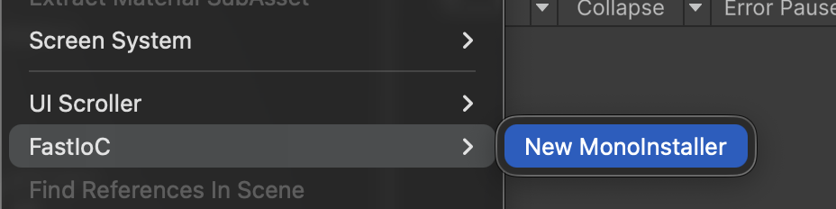

<div align="center">

# Unity Fast IoC

<sub>DESIGNED & BUILT BY</sub><br>
**✦ [`SANTIAGO GONZÁLEZ ROZO (@sgonzalezrozo)`](https://github.com/sgonzalezrozo) ✦**

Dependency injection for Unity with generated code and no runtime reflection. Missing bindings and cycles are caught before Play; 3,000 bindings inject in 11–39 ms on phones.

[](Documentation~/getting-started.md#requirements)
[](CHANGELOG.md)
[](LICENSE)

[**Installation**](#installation) • [**Key Features**](#key-features) • [**Quickstart**](#quickstart) • [**Bindings**](Documentation~/bindings.md) • [**Core Concepts**](Documentation~/core-concepts.md) • [**Code Generation**](Documentation~/code-generation.md)

<sub>[Getting Started](Documentation~/getting-started.md) • [Injection & Lifecycle](Documentation~/injection.md) • [Performance](Documentation~/performance.md) • [AI Agents](Documentation~/ai-agents.md) • [Troubleshooting](Documentation~/troubleshooting.md) • [FAQ](Documentation~/faq.md) • [Project Status](Documentation~/project-status.md)</sub>

</div>

---

## Installation

Fast IoC depends on [Tools Core](https://github.com/sgonzalezrozo/unity-tools-core). Unity doesn't install Git dependencies automatically, so add both, in this order:

1. Open **Window > Package Manager** in Unity.
2. Click **`+`** in the top-left corner and select **Add package from git URL...**
3. Paste each URL below and click **Add**:

```text
https://github.com/sgonzalezrozo/unity-tools-core.git
```

<sub>* Tools Core is needed only by Screen System, Fast IoC and UI Scroller. Add it once, even if you use several of them.</sub>

```text
https://github.com/sgonzalezrozo/unity-fast-ioc.git
```

> **Wait for each package to compile.** Add the first URL, wait until Unity finishes importing and compiling, then add the next. Adding a package while Unity is still importing the previous one can log `ScriptableSingleton already exists` and `assets located in immutable packages were unexpectedly altered`. They don't block anything: clear the Console and continue. If they come back when you open the project without adding a package, report it.

Fast IoC adds the `FAST_IoC` scripting define for all build targets when it loads; commit that Player Settings change. Requirements and tested platforms: [Getting Started](Documentation~/getting-started.md#requirements).

**Assembly references.** If your code is in an assembly definition (`.asmdef`), add `FastIoC`, `FastIoC.Core` and `ToolsCore` to its **Assembly Definition References**. Unity doesn't add them for you, and without them the build fails with `CS0246`. **New MonoInstaller** adds `FastIoC` to the folder's `.asmdef`.

---

## Key Features

* **[Feature-owned installers](Documentation~/getting-started.md#organize-bindings-by-feature)**: add an installer next to a feature's code and Fast IoC finds it.
  There's no central list to edit, so features stay self-contained and teams hit fewer merge conflicts.
* **[Errors before Play Mode](Documentation~/code-generation.md#when-generation-fails)**: dependency cycles, missing bindings and invalid assets fail generation in the Editor.
  Unbound MonoBehaviour fields are reported as warnings.
* **[No runtime reflection](Documentation~/core-concepts.md#runtime-reflection)**: registries, activators and injectors are generated at edit time.
  Scenes are injected from a baked manifest, and code stripping works with no `link.xml`.
* **[Measured on real devices](Documentation~/performance.md)**: verified in IL2CPP Release builds on Android, iOS and WebGL.
  Spawning 50 injected prefabs stays well inside a 30 fps frame, even on a low-end phone.
* **[Everything a game needs](Documentation~/bindings.md)**: singletons, scene-scoped and transient lifetimes, assets, `Lazy<T>` and `Func<T>`, startup services, prefab instantiation with data, and async initialization.

---

## Quickstart

1. Run **Tools > FastIoC > Setup**.
2. Bind a service in an installer anywhere in your project:

```csharp
[MonoInstaller]
public class GameplayInstaller : BindingRecorder
{
    public override void InstallBindings() => Bind<IInventoryService>().To<InventoryService>().AsSingle();
}
```

Or right-click a folder in the Project window and select **FastIoC > New MonoInstaller** to start one from a template.

 New MonoInstaller" width="420">

3. Receive it through an `internal` field (MonoBehaviours) or the constructor (plain classes), save, and press Play.

<details>
<summary><strong>View full sample script</strong></summary>

```csharp
using FastIoC.API;
using UnityEngine;

// 1. A service
public interface IInventoryService
{
    int ItemCount { get; }
}

public class InventoryService : IInventoryService
{
    public int ItemCount => 3;
}

// 2. Its binding. Fast IoC finds [MonoInstaller] classes on its own.
[MonoInstaller]
public class GameplayInstaller : BindingRecorder
{
    public override void InstallBindings()
    {
        Bind<IInventoryService>().To<InventoryService>().AsSingle();
    }
}

// 3a. A plain class receives it through its one public constructor.
public class ShopService
{
    private readonly IInventoryService inventory;

    public ShopService(IInventoryService inventory)
    {
        this.inventory = inventory;
    }
}

// 3b. A MonoBehaviour receives it through an internal field. Add it to a scene and press Play.
public class InventoryView : MonoBehaviour
{
    internal IInventoryService inventory;

    private void Awake()
    {
        Debug.Log($"Items: {inventory.ItemCount}"); // Items: 3
    }
}
```

</details>

The full walkthrough is in [Getting Started](Documentation~/getting-started.md).
