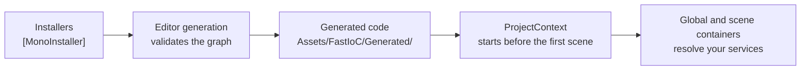

# Fast IoC

**Dependency injection for Unity with generated code and no runtime reflection.**

[](LICENSE)
[](#compatibility)
[](CHANGELOG.md)

Fast IoC is a dependency injection framework (IoC container) for Unity 6, and an alternative to Zenject/Extenject and VContainer. It generates its injection code in the Editor, reports missing bindings and dependency cycles before you press Play, and is verified in IL2CPP builds on Android and iOS phones. See [Performance](#performance).

Fast IoC generates registries, activators and injectors at edit time. The runtime uses no reflection: the generated code registers itself at startup, MonoBehaviour fields are assigned by generated code, and scene objects are listed in a manifest baked into each scene. See [Runtime reflection](#runtime-reflection).

**Each feature owns its bindings.** Add an installer next to a feature's code and Fast IoC finds it. There's no central list to edit, so features stay self-contained and teams hit fewer merge conflicts. See [Organize bindings by feature](#organize-bindings-by-feature).

<!-- Demo GIF: Documentation~/images/demo.gif -->

## Why I built it

I decided to build my own IoC framework to understand how injection really works, to control how it happens and, most of all, to improve performance.

Game projects usually start out smooth. As features pile up, performance degrades fast, but the whole team is busy building those features, so optimization tends to wait until the end. By then, optimizing injection, at least in Zenject, is painful.

Something else came up along the way. Since every declaration in Fast IoC happens at edit time, why should a binding be declared in more than one place? With Zenject, if I wanted to control a binding's lifetime without keeping the reference global, I had to repeat it in each scene context that needed it. In Fast IoC, one installer declares the binding and lists its scenes.

I built and refined it on my own time in personal projects. It isn't used in production yet. In November 2026 I extracted it into this standalone package and documented it. Earlier history lives in a private repository.

## Is it right for your project?

**Use Fast IoC if you want:**

- Feature-owned installers instead of one long project installer
- Dependency cycles, missing bindings and invalid assets caught in the Editor, before you press Play
- Generated IDs and activators for dependency resolution
- Global and scene-specific installers
- Project bootstrap that runs before the first scene loads
- Warnings or errors when code uses the container as a service locator

**Consider something else if you:**

- Don't want generated code in your project
- Need a container with a long public track record and a large community. Zenject/Extenject, VContainer and Reflex are established alternatives.

## Features

- Installer-based binding with `BindingRecorder` and `Bind<T>()`
- Auto-discovered installers, with no central list to maintain
- Registries, activators and injectors generated at edit time
- Automatic regeneration after a script compile, when installers, bindings, constructors or injected fields change
- Cycle, missing-binding and asset validation during generation, plus warnings for unbound MonoBehaviour fields
- Constructor injection for plain classes
- `Lazy<T>` and `Func<T>` dependencies, to create a service later or on demand
- `internal` field injection for MonoBehaviours
- `AsSingle`, `AsCached`, `AsTransient` and `FromInstance` bindings
- Global and scene-specific installers with priorities
- Sync and async initialization, plus disposal hooks
- Prefab instantiation with injection and data through `IInstantiator`
- Service-locator detection in the Editor and development builds

## Compatibility

| Requirement | Supported |
|---|---|
| Unity | Tested on Unity 6 (`6000.3.16f1`). The package declares `2022.3` as its minimum, but older versions aren't tested yet. |
| Scripting backend | IL2CPP (Release) verified in Android and iOS player builds with Unity `6000.3.6f1`. Mono player builds aren't tested yet. |
| Platforms | Android verified on a Pixel 5 and a Samsung Galaxy A02s, iOS on an iPhone 13 mini (iOS 26) and an iPhone Air (iOS 27). Other platforms aren't verified yet. |
| Managed code stripping | `Minimal` verified on Android and iOS, with no `link.xml`. Generated code is referenced directly and marked `[Preserve]`, but test higher stripping levels in your own player build. |
| Enter Play Mode with domain reload disabled | Not verified yet. The generated module and scene injection reset their static state on each Play Mode start, but test it before relying on it. |
| Dependencies | [Tools Core](https://github.com/sgonzalezrozo/unity-tools-core), Addressables |

## Installation

Git must be installed on your machine.

### 1. Install Tools Core

This package requires [Tools Core](https://github.com/sgonzalezrozo/unity-tools-core), the shared code that defines the injection interfaces used by Fast IoC, Screen System and Recyclable Scroller. Unity doesn't install Git dependencies automatically, so add it first.

1. In Unity, open **Window > Package Manager**.
2. Select **+ > Add package from git URL**.
3. Enter:

```text
https://github.com/sgonzalezrozo/unity-tools-core.git
```

### 2. Install this package

1. In Unity, open **Window > Package Manager**.
2. Select **+ > Add package from git URL**.
3. Enter:

```text
https://github.com/sgonzalezrozo/unity-fast-ioc.git
```

To pin a release, add its tag:

```text
https://github.com/sgonzalezrozo/unity-fast-ioc.git#v0.4.0
```

Fast IoC adds the `FAST_IoC` scripting define for all build targets when it loads. This changes your project's Player Settings, so commit that change.

## Setup

1. Run **Tools > FastIoC > Setup**.
2. Confirm that `Assets/Resources/Tools/FastIoC/ProjectContext.prefab` was created.
3. Add your first installer, as shown in [Quick start](#quick-start). Fast IoC then creates `Assets/FastIoC/Generated/`.
4. Commit the prefab and generated folder. The generated code is needed in player builds. See [Generated code](#generated-code).

## Quick start

### 1. Define a service

```csharp
public interface IInventoryService
{
    int ItemCount { get; }
}

public class InventoryService : IInventoryService
{
    public int ItemCount => 3;
}
```

### 2. Bind it

```csharp
using FastIoC.API;

[MonoInstaller]
public class GameplayInstaller : BindingRecorder
{
    public override void InstallBindings()
    {
        Bind<IInventoryService>().To<InventoryService>().AsSingle();
    }
}
```

### 3. Inject it

Plain classes receive dependencies through their public constructor:

```csharp
public class ShopService
{
    private readonly IInventoryService inventory;

    public ShopService(IInventoryService inventory)
    {
        this.inventory = inventory;
    }
}
```

MonoBehaviours receive them through `internal` fields:

```csharp
using UnityEngine;

public class InventoryView : MonoBehaviour
{
    internal IInventoryService inventory;

    private void Start()
    {
        Debug.Log($"Items: {inventory.ItemCount}");
    }
}
```

The field must be `internal`, so the generated code can assign it directly. Public and private fields aren't injected. Give each service one public constructor.

### 4. Press Play

Fast IoC regenerates after your scripts compile, so save your files and let Unity finish. Add `InventoryView` to a scene and press Play to see `Items: 3` in the Console.

## Organize bindings by feature

Project installers tend to grow into one long file that every feature has to edit. With Fast IoC, each feature can own its bindings in its own installer:

```csharp
using FastIoC.API;

[MonoInstaller]
public class InventoryInstaller : BindingRecorder
{
    public override void InstallBindings()
    {
        Bind<IInventoryService>().To<InventoryService>().AsSingle();
    }
}

[MonoInstaller]
public class ShopInstaller : BindingRecorder
{
    public override void InstallBindings()
    {
        Bind<IShopService>().To<ShopService>().AsSingle();
    }
}
```

Fast IoC discovers classes with `[MonoInstaller]` automatically, so there's no central list or scene reference to update.

- **Adding a feature:** add its installer, without editing a shared file.
- **Removing a feature:** delete its installer along with its code.
- **Working in a team:** features change separate files, which reduces merge conflicts.
- **Finding bindings:** each feature's bindings live next to its code.

## How it works



The game runs the generated code, not your installers. The one exception is an installer with a [`FromInstance(value)`](#bind-existing-objects) binding, which also runs once at startup.

## Core concepts

| Concept | Meaning |
|---|---|
| Installer | A `BindingRecorder` class with `[MonoInstaller]` that declares bindings in `InstallBindings()` |
| Binding | A rule that tells the container what to provide for a type |
| Project context | The prefab that starts the container before the first scene loads |
| Generated code | The registries, activators and injectors in `Assets/FastIoC/Generated/` |

## Binding reference

```csharp
public override void InstallBindings()
{
    Bind<IMusicService>().To<MusicService>().AsSingle();
    Bind<IEnemyFactory>().To<EnemyFactory>().AsCached();
    Bind<IDamageCalculator>().To<DamageCalculator>().AsTransient();
    Bind<PlayerSessionModel>().AsSingle();
    Bind<GameConfig>().FromInstance("GameConfig").AsSingle();
}
```

| Binding | Behavior |
|---|---|
| `AsSingle()` | One shared instance, created on first resolve |
| `AsCached()` | One cached instance, cleared when a scene unloads. Use this to tie an instance to a scene. |
| `AsTransient()` | A new instance for each resolve. This is the default lifetime. |
| `FromInstance(value)` | A singleton using an object you create. See [Bind existing objects](#bind-existing-objects). |
| `FromInstance(assetPath).AsSingle()` | A singleton loaded from a prefab or ScriptableObject. See [Bind assets](#bind-assets). |

A scene-specific `AsSingle()` instance stays cached after its scene unloads, so use `AsCached()` when the instance shouldn't outlive the scene.

## Bind assets

Use `FromInstance` for a prefab or ScriptableObject that the game needs as a single shared service:

```csharp
using FastIoC.API;

namespace MyGame.Shop
{
    [MonoInstaller("MainMenu", "Shop", Priority = 200)]
    public class ShopInstaller : BindingRecorder
    {
        public override void InstallBindings()
        {
            Bind<ShopModel>().AsSingle();
            Bind<ShopConfig>().FromInstance("ShopConfig").AsSingle();
        }
    }
}
```

- **Finish with `AsSingle()`.** `FromInstance(assetPath)` doesn't record the binding by itself.
- **Pass the asset's name or its full path.** `"ShopConfig"` searches the project and uses the first match. A value containing `/` must be the full path, such as `Assets/Resources/Config/ShopConfig.asset`.
- **Keep these assets in a `Resources` folder.** Fast IoC also accepts assets marked as Addressable. Generation fails for an asset that's in neither.
- **Prefabs must have the bound type on their root.** Fast IoC instantiates the prefab at startup.
- **ScriptableObjects must be assignable to the bound type.**

Other prefabs don't belong here. Keep them in Addressables and load them when needed. Screens, for example, are loaded by [Screen System](https://github.com/sgonzalezrozo/unity-screen-system).

## Bind existing objects

Use `FromInstance(value)` for a plain object that needs specific values, or a type the container can't construct:

```csharp
Bind<IGameClock>().FromInstance(new FixedClock(startHour: 8));
```

A value can't be saved at edit time, so Fast IoC runs this installer once more when the game starts, and registers the object it gets:

- **Build the value from code that works in the game and in the Editor.** The installer runs in both.
- **Don't create scene objects in the installer.** It also runs during every generation.
- **Installers with this binding need a public parameterless constructor.**
- **The value is shared across all scenes.** It's registered at startup, even if the installer lists scene names.

## Scene-specific installers

```csharp
using FastIoC.API;

[MonoInstaller("MainMenu", "Shop", Priority = 200)]
public class MenuInstaller : BindingRecorder
{
    public override void InstallBindings()
    {
        Bind<UiSessionModel>().AsSingle();
    }
}
```

- The strings are scene names.
- `[MonoInstaller]` with no scene names is global.
- Installers with a higher `Priority` run first. The default is `0`.
- Set `Disabled = true` on the attribute to exclude an installer.

## Instantiating prefabs

Inject `IInstantiator` to create prefabs with dependencies:

```csharp
using FastIoC.Core;
using UnityEngine;

public class EnemySpawner : MonoBehaviour
{
    [SerializeField] private GameObject enemyPrefab;

    internal IInstantiator instantiator;

    public EnemyView Spawn()
    {
        return instantiator.Instantiate<EnemyView>(enemyPrefab, transform);
    }
}
```

The component type must implement `IInstanciable`, or a child interface such as `IInjectableForChildren`.

### Pass data to a prefab

Implement `IInjectableForChildren<T>` and pass the data to `Instantiate`. Fast IoC sets `Data` before it fills the container fields, so it's ready in `Awake()` once the instance activates:

```csharp
using FastIoC.Core;
using UnityEngine;

public class EnemyView : MonoBehaviour, IInjectableForChildren<EnemyData>
{
    public EnemyData Data { get; set; }
}

// In the spawner:
EnemyView boss = instantiator.Instantiate<EnemyView>(enemyPrefab, transform, data: bossData);
```

### Reference other components of the prefab

An `internal` field whose type is a MonoBehaviour is filled with a component of that type from the same instantiated prefab, if the field is still empty:

```csharp
public class EnemyController : MonoBehaviour
{
    internal EnemyModel model; // the EnemyModel on this prefab
}
```

Fields you assign in the Inspector are left as they are.

### Objects created outside Fast IoC

Scenes loaded at any time are injected when they load. For an object you create with `Object.Instantiate` or `AddComponent`, call `SceneInjector.InjectIfNeeded(component)`.

## Create dependencies later

Ask for `Lazy<T>` or `Func<T>` instead of `T` when a dependency shouldn't be created with the class, or when you need a new instance on demand:

```csharp
using System;

public class SaveService
{
    private readonly Lazy<ICloudSync> cloud;
    private readonly Func<EnemyAI> createEnemyAI;

    public SaveService(Lazy<ICloudSync> cloud, Func<EnemyAI> createEnemyAI)
    {
        this.cloud = cloud;
        this.createEnemyAI = createEnemyAI;
    }

    public void Upload() => cloud.Value.Push();      // ICloudSync is created here, the first time
    public EnemyAI Spawn() => createEnemyAI();       // resolves EnemyAI on every call
}
```

- **`Lazy<T>`** resolves `T` the first time you read `.Value`, then keeps it.
- **`Func<T>`** resolves `T` on every call, so `T`'s lifetime decides what you get: a new instance for `AsTransient()`, the same one for `AsSingle()`.
- **Both work in constructors and in `internal` MonoBehaviour fields**, such as `internal Lazy<IShopService> shop;`.
- **`T` must be bound.** Generation fails for a constructor parameter and warns for a field, as it does for `T` itself.
- **They don't count as cycles.** Nothing is created in a loop at startup, so `A(Lazy<B>)` with `B(A)` is allowed. Don't read `.Value` in the constructor, or the loop comes back.
- **They resolve when used.** A field whose `T` is bound only in another scene throws when it's used, instead of staying `null`.
- `Func<T>` takes no arguments. Factories with runtime parameters aren't supported yet.

## Lifecycle

```csharp
using FastIoC.Core;

public class SaveSystem : IInitializable, IDisposableHook
{
    public void Initialize() { }
    public void OnDispose() { }
}
```

Services can also implement `IAsyncInitializable`:

```csharp
using System.Threading;
using System.Threading.Tasks;
using FastIoC.Core;

public class RemoteConfigService : IAsyncInitializable
{
    public async Task InitializeAsync(CancellationToken ct = default)
    {
        await Task.Delay(100, ct);
    }
}
```

- Async initialization doesn't block the first scene, so check that a service is ready before using it.

## Generated code

Fast IoC writes these files to `Assets/FastIoC/Generated/`:

| File | Contents |
|---|---|
| `GeneratedTypeIds.cs` | An ID for each type |
| `GeneratedActivators.cs` | The code that creates each service |
| `GeneratedMonoInjectors.cs` | The code that fills `internal` MonoBehaviour fields, prefab data and local references |
| `GeneratedModule.cs` | Registers the generated code with the runtime at startup |
| `GeneratedRegistry.cs` | Global and scene bindings |
| `GeneratedInstanceRegistry.cs`, `InstanceRegistryInitializer.cs` | Assets bound with `FromInstance` |
| `GenerationStatus.json` | The result of the last generation |

If a MonoBehaviour with `internal` injected fields lives in an assembly definition under `Assets/`, Fast IoC also writes `FastIoC.InternalsVisibleTo.g.cs` next to that `.asmdef`, so the generated code in `Assembly-CSharp` can assign those fields. Commit it too. Assemblies in packages are never modified: add `[assembly: InternalsVisibleTo("Assembly-CSharp")]` to them yourself.

### Scene manifests

When Unity builds a scene, and when a scene loads in Play Mode in the Editor, Fast IoC adds a hidden `SceneInjectionManifest` to it. It holds references to the scene's injectable MonoBehaviours and the index of each one's injector, so scene injection doesn't search the scene. The scene asset itself is never changed. If a scene has no manifest, for example when Play Mode starts without reloading the scene, Fast IoC finds the objects with `FindObjectsByType` instead.

### What to commit

Commit the `.cs` files and their `.meta` files, because player builds need them. Ignore the status file, because it changes on every generation and is only read in the Editor:

```text
Assets/FastIoC/Generated/GenerationStatus.json
Assets/FastIoC/Generated/GenerationStatus.json.meta
```

### When regeneration runs

Fast IoC checks for changes after each script compile, and regenerates when you've changed:

- An installer, including adding or removing one
- A binding, or the scenes or priority of its installer
- The constructor of a bound type
- An `internal` field on a MonoBehaviour

It also regenerates when you delete a script. After a failed generation, it tries again on the next compile. To regenerate at any time, run **Tools > FastIoC > Regenerate Code**.

### Run it in CI

There's no dedicated CI command yet, but generation can be called with `-executeMethod`:

```bash
unity -batchmode -quit -projectPath . \
  -executeMethod FastIoC.Editor.Generation.GenerationCoordinator.GenerateAll
```

Generation catches its own errors, so Unity can still exit with code `0` after a failed run. Check the status file afterward. A value of `1` means it failed:

```bash
if grep -q '"status": *1' Assets/FastIoC/Generated/GenerationStatus.json; then exit 1; fi
```

### When generation fails

- The errors are logged in the Console, and `GenerationStatus.json` records them.
- The previous generated files stay in place.
- Entering Play Mode logs `CODE GENERATION FAILED` and pauses the Editor.
- Player builds aren't blocked, so a build can ship with the last good generated code.

### Example: a dependency cycle

```csharp
public class OrderService
{
    public OrderService(PaymentService payment) { }
}

public class PaymentService
{
    public PaymentService(OrderService order) { }
}
```

If both are bound, generation fails, and Play Mode shows:

```text
[FastIoC] CODE GENERATION FAILED
Last attempt: <time>
Error: Dependency graph contains cycles

Details:
  • Cycle detected: PaymentService -> OrderService

Fix the issues and regenerate code:
Tools > FastIoC > Regenerate Code
```

### Example: a missing binding

```csharp
public class ShopService
{
    // IPaymentGateway has no binding in any installer.
    public ShopService(IPaymentGateway gateway) { }
}
```

If `ShopService` is bound, generation fails, and Play Mode shows:

```text
[FastIoC] CODE GENERATION FAILED
Last attempt: <time>
Error: Dependency graph has missing bindings

Details:
  • ShopService requires IPaymentGateway, which isn't bound in any installer.

Fix the issues and regenerate code:
Tools > FastIoC > Regenerate Code
```

Constructor parameters with a default value are skipped.

### Example: an unbound MonoBehaviour field

```csharp
public class ShopView : MonoBehaviour
{
    // IShopService has no binding in any installer.
    internal IShopService shop;
}
```

Generation still succeeds, because an `internal` field isn't always a dependency, but nothing fills this one. Fast IoC warns about `internal` fields whose type is an interface or abstract class from your code with no binding, and lists them under `warnings` in `GenerationStatus.json`:

```text
[FastIoC] 1 `internal` field(s) have a service type that isn't bound in any installer, so they stay null.
  • ShopView.shop (IShopService)
```

Fields of concrete classes aren't checked, because they're often plain state. Fields with another container's `[Inject]` attribute are skipped too, so a project moving from Zenject or VContainer doesn't get a warning for every field the old container still fills.

## Editor commands

| Command | Use it when |
|---|---|
| `Tools/FastIoC/Setup` | Setting up a project for the first time |
| `Tools/FastIoC/Regenerate Code` | Regenerating without waiting for a compile |

## Runtime reflection

The runtime doesn't use reflection:

- The generated `GeneratedModule` registers itself with `[RuntimeInitializeOnLoadMethod]`, so nothing searches assemblies for generated types.
- Generated injectors assign `internal` MonoBehaviour fields directly.
- Scenes are injected from a baked `SceneInjectionManifest`.
- Prefabs instantiated through `IInstantiator` or `IPrefabInstantiator` get their data (`IInjectableForChildren<T>`), container fields and local references from generated code.

Generation falls back to reflection only for an `internal` field in a package that doesn't expose its internals to `Assembly-CSharp`. Generation lists these fields in the Console, and `GeneratedMonoInjectors.ReflectionFallbackFieldCount` says how many there are. Add `[assembly: InternalsVisibleTo("Assembly-CSharp")]` to that package to remove the fallback.

Service-locator detection still reads stack traces, in the Editor and development builds only.

Test IL2CPP builds with code stripping enabled before shipping.

## Performance

Measured in IL2CPP Release builds on four phones, with Unity `6000.3.6f1`, `Minimal` stripping and incremental GC. The test project has 3,000 bindings, 1,500 injected MonoBehaviours in 100 features and dependency chains up to 12 deep, roughly the size of a mobile multiplayer game. Each value is the median of 5 cold launches.

| Metric | Pixel 5 (mid-range Android) | Galaxy A02s (low-end Android) | iPhone 13 mini (2021) | iPhone Air (2025) |
|---|---|---|---|---|
| Build the global container | 9.7 ms | 21.2 ms | 6.4 ms | 4.2 ms |
| Inject the first scene (1,500 objects) | 28.9 ms | 102.5 ms | 8.1 ms | 6.4 ms |
| Re-inject the scene after a reload, median / p95 | 11.5 / 15.3 ms | 23.0 / 25.9 ms | 2.0 / 3.2 ms | 4.1 / 4.8 ms |
| Spawn 50 injected prefabs, median / p95 | 3.3 / 6.3 ms | 7.2 / 10.4 ms | 3.0 / 5.0 ms | 2.3 / 3.4 ms |
| Managed heap after startup (same scene without DI) | 1.81 MB (0.89 MB) | 1.19 MB (0.69 MB) | 1.80 MB (0.89 MB) | 1.81 MB (0.89 MB) |
| Garbage for 1,000 prefab spawns (same scene without DI) | 116 KB (108 KB) | 56 KB (48 KB) | 124 KB (116 KB) | 120 KB (120 KB) |

- **Startup runs once, while the first scene loads.** On the same phones, Unity itself takes about 430 ms (Pixel 5) and 770 ms (A02s) to load that scene. On both iPhones, the whole startup costs Fast IoC less than one 30 fps frame.
- **Spawning fits in a frame.** A batch of 50 prefabs stays well under the 33 ms of a 30 fps frame, even on the A02s.
- **Garbage stays close to plain Unity.** Spawning 1,000 prefabs allocates at most 8 KB more than the same prefabs without DI.

The raw results for every run are in [`Benchmarks~/results/raw/`](Benchmarks~/results/raw/), and [`Benchmarks~/README.md`](Benchmarks~/README.md) explains how to run the same tests on your own devices. Numbers from your own project will differ, so measure it.

## How it compares

| | Fast IoC | [Extenject (Zenject)](https://github.com/Mathijs-Bakker/Extenject) | [VContainer](https://vcontainer.hadashikick.jp/) | [Reflex](https://github.com/gustavopsantos/Reflex) |
|---|---|---|---|---|
| Where bindings live | Feature installers, found automatically | Installers added to a context | `LifetimeScope` classes | Installers on a scope |
| Scene scoping | Scene names on the installer | `SceneContext` | Child `LifetimeScope`s | Scene containers that inherit from the root |
| Reflection | None at runtime. See [Runtime reflection](#runtime-reflection). | Used by default, with optional reflection baking | Used by default, with an optional Roslyn source generator | Reduced with an optional Roslyn source generator |
| MonoBehaviour injection | `internal` fields | `[Inject]` | `[Inject]` | `[Inject]` |
| Requires generated code in your project | Yes | No | No | No |
| Track record | Pre-release, single author | Long-established, large community | Established, active community | Established, active community |

**Choose Fast IoC** for feature-owned installers and edit-time generation. **Choose one of the others** if you want a proven container or no generated files. Each project publishes its own benchmarks, so compare them against your own workload.

## Use it with AI coding agents

Coding agents follow the patterns they find in a project. Without instructions, they tend to share services in Unity through singletons, `FindObjectOfType` and Inspector references. Give them the Fast IoC rules and they wire dependencies the same way you do:

1. Copy [`Documentation~/agent-rules.md`](Documentation~/agent-rules.md) into your project's agent rules, for example `AGENTS.md`, `CLAUDE.md` or `.cursor/rules/fast-ioc.md`.
2. Keep the generated folder committed, so the agent can read which bindings exist.

Fast IoC suits agents for a few reasons:

- **Dependencies are visible in code.** A constructor or an `internal` field shows what a class needs, without opening scenes or prefabs.
- **The agent can check its own work.** After a compile, `Assets/FastIoC/Generated/GenerationStatus.json` reports missing bindings and dependency cycles, and generation can run in batch mode. See [Run it in CI](#run-it-in-ci).
- **Each feature owns its installer.** An agent adds a feature without editing a shared file.
- **Plain classes are easy to test.** Pass fakes to the constructor in a unit test.

There are no MCP tools for Fast IoC yet. The rules file works with any agent that reads project files.

## FAQ

### How do I do dependency injection in Unity?

Bind each service in an installer, then receive it through a constructor (plain classes) or an `internal` field (MonoBehaviours). Fast IoC generates the code that connects them. See [Quick start](#quick-start).

### Fast IoC vs Zenject (Extenject) vs VContainer: which should I use?

All three are dependency injection containers for Unity. Fast IoC generates its injection code in the Editor, so it uses no reflection at runtime, catches missing bindings and cycles before Play Mode, and finds feature installers on its own. Zenject and VContainer have more binding features and a long track record, and they don't add generated files to your project. See [How it compares](#how-it-compares) and [Limitations](#limitations).

### Does it work with IL2CPP and mobile?

Yes. It's verified in IL2CPP Release builds with `Minimal` code stripping on Android (a mid-range and a low-end phone) and iOS (an iPhone 13 mini and an iPhone Air). WebGL isn't verified yet. See [Performance](#performance).

### Does it work with Unity 6?

Yes. It's tested on Unity `6000.3`. The package declares `2022.3` as its minimum, but older versions aren't tested yet.

### Does it use reflection?

Not at runtime. Registries, activators and injectors are generated at edit time, and scenes are injected from a baked manifest. See [Runtime reflection](#runtime-reflection).

### How do I inject into a MonoBehaviour?

Declare the dependency as an `internal` field and use it from `Start()`. There's no `[Inject]` attribute:

```csharp
public class InventoryView : MonoBehaviour
{
    internal IInventoryService inventory;
}
```

### Can I inject ScriptableObjects?

Yes. Bind the asset with `FromInstance` and finish with `AsSingle()`. The asset must be in a `Resources` folder or marked as Addressable. See [Bind assets](#bind-assets).

```csharp
Bind<GameConfig>().FromInstance("GameConfig").AsSingle();
```

### How do I spawn prefabs with dependencies?

Inject `IInstantiator` and call `Instantiate<T>`. You can also pass data that's ready in `Awake()`. See [Instantiating prefabs](#instantiating-prefabs).

### How do I make Unity code testable?

Move logic out of MonoBehaviours into plain classes that receive their dependencies through the constructor. A unit test creates the class with `new` and passes fakes, with no container or scene. Fast IoC doesn't include test helpers yet.

```csharp
var shop = new ShopService(new FakeInventory(itemCount: 0));
Assert.IsFalse(shop.CanBuy());
```

### How much does it cost at startup?

With 3,000 bindings and 1,500 injected MonoBehaviours, building the container and injecting the first scene takes about 11 ms on an iPhone Air, 15 ms on an iPhone 13 mini, 39 ms on a Pixel 5 and 124 ms on a Galaxy A02s. See [Performance](#performance).

### Can it run alongside another container?

Yes. Set `FastIoCUnityBootstrapper.AutoStart` to `false` from a `[RuntimeInitializeOnLoadMethod(RuntimeInitializeLoadType.SubsystemRegistration)]` method, then call `FastIoCUnityBootstrapper.Start()` when you want it. The benchmark project uses this to run several containers in one build.

### Does it work with AI coding agents?

Yes, through a rules file you copy into your project. See [Use it with AI coding agents](#use-it-with-ai-coding-agents).

### Is it production-ready?

Not yet. It's a pre-release package (`0.x`) by a single author, not yet used in a shipped game. See [Project status](#project-status).

## Troubleshooting

| Problem | Try this |
|---|---|
| Play Mode stops with `CODE GENERATION FAILED` | Fix the listed errors, then run **Regenerate Code** |
| `requires ..., which isn't bound in any installer` | Bind the type, or give the constructor parameter a default value |
| `Could not resolve asset path` | Use the asset's name or its full `Assets/...` path |
| `neither in Resources/ folder nor marked for Addressables` | Move the asset to a `Resources` folder or mark it as Addressable |
| `TypeId ... is not registered` | Add a binding, and check that its scene installer applies to the active scene |
| A MonoBehaviour field stays `null` | Make the field `internal`, bind its type, and use it from `Start()`. Check `warnings` in `GenerationStatus.json`. |
| `These private fields have a bound type but aren't injected` | Make the field `internal` if it's a dependency. If it's private state, ignore the warning. |
| `injected field(s) still use reflection` | The listed fields are `internal` in an assembly that doesn't expose its internals. Add `[assembly: InternalsVisibleTo("Assembly-CSharp")]` to it, then regenerate. |
| `Generated code is not registered` | Run **Regenerate Code**, and check that `Assets/FastIoC/Generated/GeneratedModule.cs` exists |
| `Service Locator Anti-Pattern Detected` | Inject the dependency instead of resolving it from `ContextRuntime`. The default level is strict, so this throws in the Editor and development builds. |

## Limitations

- MonoBehaviour fields must be `internal`. Local references inside an instantiated prefab are also filled only for `internal` fields.
- Generation only warns about unbound MonoBehaviour fields typed as an interface or abstract class. Unbound fields of concrete classes aren't reported.
- Installers with a `FromInstance(value)` binding run once more at startup.
- A failed generation doesn't block player builds.
- Installers run in the Editor during generation, so don't rely on runtime-only state in `InstallBindings()`. Bindings are fixed when the code is generated and can't change at runtime.
- Bindings are by type only. There are no named or ID bindings, and no value bindings: `Bind<T>()` takes a class, so put configuration such as an `int` or a URL in a typed config class and bind that.
- `Func<T>` takes no arguments: there are no factories with runtime parameters yet. There are no decorators or open generic bindings either. Bind each closed type, such as `IRepository<Player>`, on its own.

## Project status

This is a pre-release package at version `0.4.0`. Its API and behavior may change before `1.0.0`. Not yet used in a shipped game. There's no automated test suite yet.

Until `1.0.0`, minor versions (`0.x.0`) can include breaking changes, and patch versions (`0.x.y`) don't. Breaking changes are marked **Breaking** in the [changelog](CHANGELOG.md).

There's no public roadmap yet. Known gaps are listed under [Limitations](#limitations), and planned work is tracked in [issues](https://github.com/sgonzalezrozo/unity-fast-ioc/issues).

## Contributing

Bug reports and pull requests are welcome. Please open an issue before starting a large change. See the [contributing guide](.github/CONTRIBUTING.md) and [security policy](.github/SECURITY.md).

## Related packages

| Package | Purpose |
|---|---|
| [Screen System](https://github.com/sgonzalezrozo/unity-screen-system) | Declarative UI navigation |
| [UI Tweens](https://github.com/sgonzalezrozo/unity-ui-tweens) | ECS-based UI animation |
| [Recyclable Scroller](https://github.com/sgonzalezrozo/unity-recyclable-scroller) | Virtualized lists |
| [Enhanced Console](https://github.com/sgonzalezrozo/unity-enhanced-console) | Unity Editor log triage |
| [Tools Core](https://github.com/sgonzalezrozo/unity-tools-core) | Shared injection code, required by this package |

## License

Released under the [MIT License](LICENSE).
